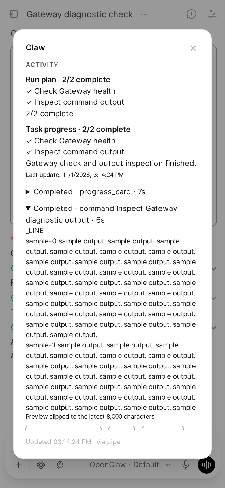

# Task activity and command output

The Marvin bridge adds a Task activity block to tool-using replies. Its summary names the latest action and shows the number of completed plan steps. Expand it to see progress notes, current steps and command output while the tool is running. Open the composer's Status button for the Activity panel, including recent results and retained output.

Applies to: Pipe and Status Action, installed together from the same Marvin release.

## What the display means

Task progress is the session's saved progress card, read through `progressCard.get`. Run plan is a plan event from the current run. They are separate because a run can end with unfinished task steps. Ending a response never marks pending steps complete.

A running command shows a rolling preview of the latest 8,000 characters. The preview is replaced with each snapshot; repeated snapshots do not append duplicate output. Native tool cards still show the final result. Failed, interrupted and completed calls have separate states. A command that returns a background-process receipt is labelled Background; its ongoing process belongs to the existing Background section. A launch receipt is not treated as command success.

Titles use the tool's supplied title or description, or a file path for file tools. Untitled shell calls use “Run command.” The bridge does not ask a model to invent a description or require an agent to narrate every call.

## Inspect a retained result

1. Open Status in the chat or under the relevant model's reply.
2. Expand the command under Activity.
3. Select **Load retained output** to fetch the message from the Gateway. This reads the retained transcript, not the clipped Open WebUI tool preview.
4. Select **Copy** or **Download** to save the text currently displayed.

The Gateway may report a result as missing, oversized or no longer visible. If the Gateway itself retained truncated content, the panel says so. Download cannot recover text the Gateway did not retain.

## Recovery and boundaries

Opening Activity reads the saved card and recent Gateway history, including an in-flight snapshot when present. The panel refreshes every two seconds while it is open and the tab is visible. Closing the panel stops its polling. Chat ownership and the dialog's session are checked before a read; retained-message references must belong to the displayed tool call.

The panel shows at most 20 recent calls from the last 50 history messages. Live state holds at most 50 calls per run and 128 sessions in memory. It is a view of the Gateway's state, not a second permanent transcript archive. The existing bridge writer persists a separate activity record with the reply. A bridge-owned view renders it through the same execute channel as the Status panel. It never enters the assistant answer text or model context. Reopening a chat restores the saved view and the process's latest received snapshot.

A saved card is the last confirmed snapshot, with its update time. A newer run plan can appear before the corresponding saved-card read completes. The two labels preserve that distinction. Open Activity to read the latest saved state after the run ends.

## Installation and versions

This release is tested with Open WebUI 0.12.5 and OpenClaw 2026.10.9. It uses the existing [Status Action configuration](../configuration.md#state_dir) and paired Gateway connection. There are no new valves, Gateway plugins or agent instructions to install. Existing tools, questions, approvals and sub-agent controls remain handled by the upstream bridge.

See [maintaining the Marvin fork](../marvin-maintenance.md) for release checks, updates and rollback.
